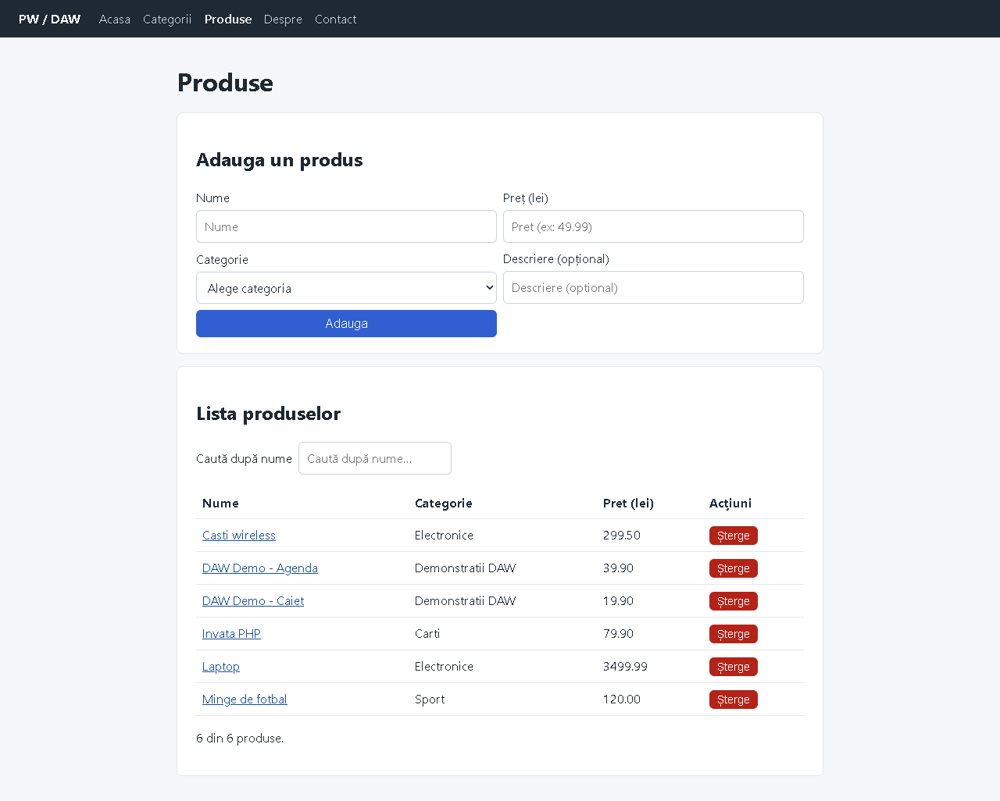
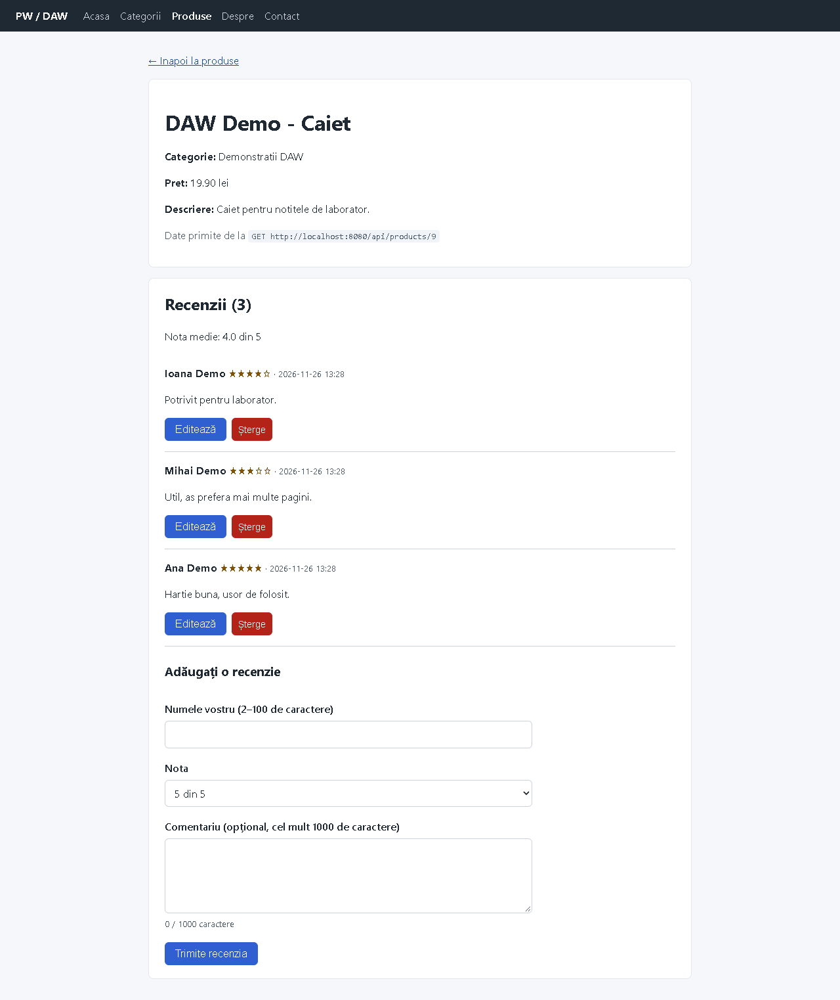

# PW/DAW — Produse și recenzii

Alexandru Anchidin · branch `alexandru.anchidin`

Aplicație de laborator pentru categorii, produse și recenzii. Recenziile pot fi adăugate, editate și șterse, cu validare și afișarea mediei notelor.

**Tehnologii:** Symfony 8, PHP 8.5, PostgreSQL 18, Doctrine, React 19, Vite, Docker Compose.

## Pornire

Necesită Git și Docker Desktop pornit. Comenzi PowerShell:

```powershell
git clone --branch alexandru.anchidin --single-branch https://github.com/cezarpapara/daw-template-ti-info-2026-2027.git
cd daw-template-ti-info-2026-2027
docker compose -f backend/compose.yaml up -d --build
docker exec daw-php composer install --no-interaction
docker exec daw-php php bin/console doctrine:database:create --if-not-exists
docker exec daw-php php bin/console doctrine:migrations:migrate --no-interaction
docker exec daw-php php bin/console doctrine:schema:validate
Get-Content -Raw -Encoding UTF8 backend/app/sql/date-exemplu.sql | docker exec -i daw-postgres psql -U daw -d daw -v ON_ERROR_STOP=1
docker compose -f frontend/compose.yaml up -d --build
```

[Aplicație](http://localhost:5173/) · [Swagger](http://localhost:8080/api/doc)

La pornirile următoare sunt suficiente cele două comenzi `compose ... up -d`. Pentru oprire, înlocuiește `up -d` cu `stop`. Porturi: 5173, 8080, 5432. Configurația privată se păstrează în `.env.local`.

## Verificare

```powershell
node tests/api.mjs
docker exec daw-react npm run build
```

Testele HTTP necesită Node ≥ 20 și API-ul pornit. Colecția Postman este în `postman/`. CRUD-ul este demonstrativ, fără autentificare.

## Lighthouse Desktop

Scoruri înainte → după:

| Pagină | Performance | Accessibility | Best Practices | SEO |
| --- | --- | --- | --- | --- |
| Acasă | 100 → 95 | 100 → 100 | 100 → 100 | 82 → 100 |
| Produse | 100 → 98 | 94 → 100 | 100 → 100 | 82 → 100 |
| Detalii | 72 → 74 | 100 → 100 | 100 → 100 | 82 → 100 |

[Rapoarte HTML](docs/lighthouse/). Audit pe servere de dezvoltare: înainte Vite local, după Vite în Docker; Performance este orientativ. Îmbunătățiri: titluri/descriere, etichete, antete de tabel, contrast și focus vizibil.

## Capturi




## Contribuții

Template: Cezar-Marian Papară. Extensiile de pe branch: exerciții HTML/CSS/JavaScript, componente React, recenzii, validare și teste. [Plan](docs/PLAN.md) · [Verificări](docs/lab12-calitate-predare.md).
