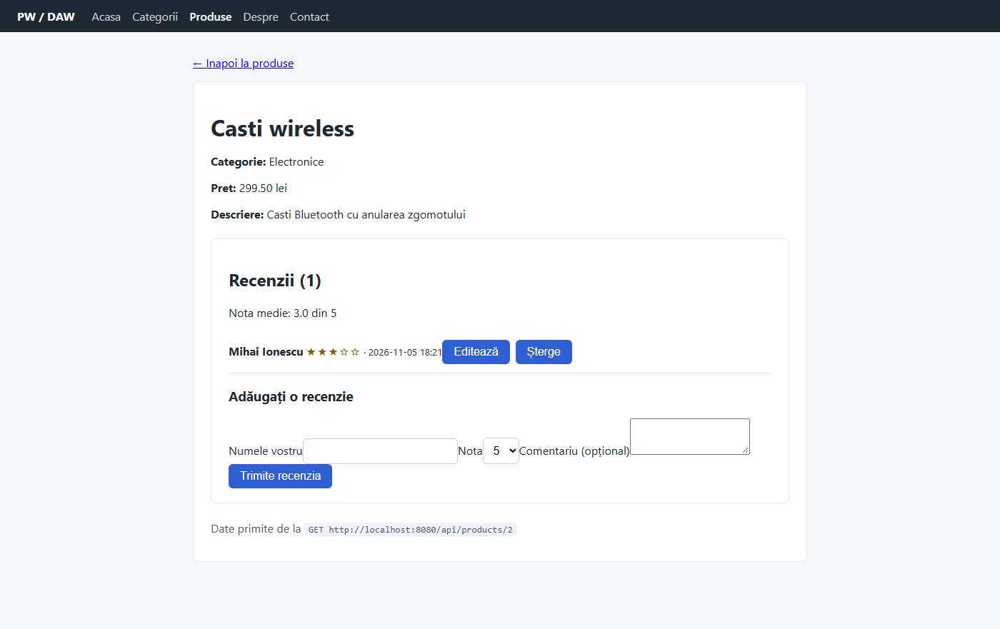

# Magazinul nostru – proiect PW/DAW 2026–2027

Aplicație web demonstrativă pentru un magazin online: produsele sunt organizate pe categorii, iar vizitatorii pot lăsa recenzii (nume, notă de la 1 la 5, comentariu). Interfața React comunică printr-un API REST cu backend-ul Symfony, care validează datele și le salvează în PostgreSQL.

## Tehnologii

Symfony 8 (PHP 8.5), PostgreSQL 18, Doctrine ORM, React 19 + Vite, Docker Compose.

## Rulare

1. git clone https://github.com/cezarpapara/daw-template-ti-info-2026-2027.git
2. git checkout chirila.razvan
3. docker compose -f backend/compose.yaml up -d --build
4. docker compose -f frontend/compose.yaml up -d --build
5. docker exec -it daw-php composer install
6. docker exec -it daw-php php bin/console doctrine:migrations:migrate
7. Datele de exemplu: backend/app/sql/date-exemplu.sql (rulat în DBeaver)
8. Interfața: http://localhost:5173 · API: http://localhost:8080/api/doc

## Capturi de ecran

## Contribuția fiecărui membru

- Chirilă Răzvan (proiect individual): entitățile și API-ul pentru recenzii, validarea, paginile React, formularele, auditul Lighthouse.

## Scoruri Lighthouse (Desktop, Navigation)

| Pagina | Accessibility | Best Practices | SEO |
|---|---|---|---|
| Acasă – înainte | 100 | 100 | 82 |
| Acasă – după | 100 | 100 | 100 |
| Produse – înainte | 93 | 100 | 82 |
| Produse – după | 100 | 100 | 100 |
| Produs (/produse/2) – înainte | 100 | 100 | 82 |
| Produs (/produse/2) – după | 100 | 100 | 100 |

Performance înainte (pe serverul Vite de dezvoltare, deci orientativ): Acasă 58, Produse 57, Produs 61.
Rapoartele complete sunt în `docs/capturi/` (`*_inainte.html`, `*_dupa.html`).

Îmbunătățiri aplicate:
- imagine redimensionată la 300×200 și salvată ca WebP, cu `width`, `height` și `loading="lazy"`;
- `<title>` în fiecare pagină și `<meta name="description">` în `index.html`;
- etichete `<label>` pentru toate câmpurile din formulare, antet pentru coloana de acțiuni din tabel;
- contrast mai mare pentru butonul de ștergere (5,7:1);
- `robots.txt` valid în `public/`.
