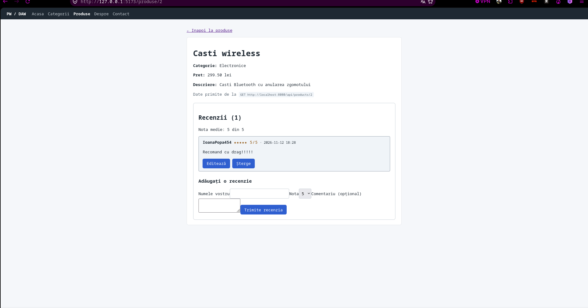
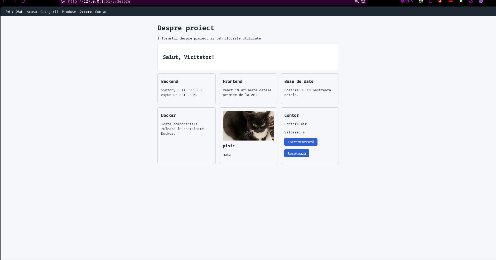
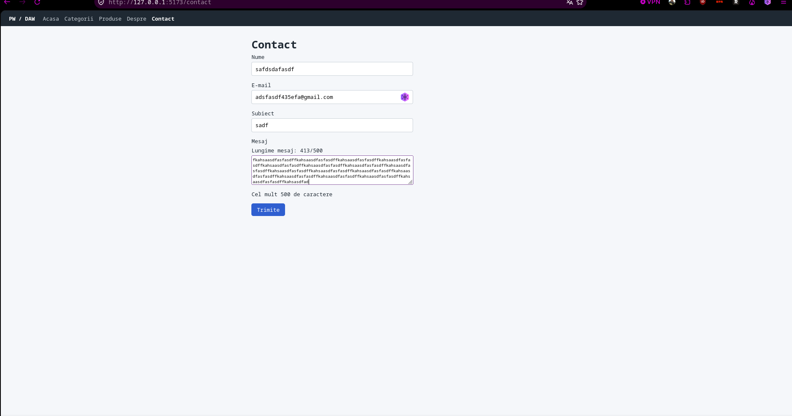

# Magazinul nostru – proiect PW/DAW 2026–2027
Aplicație web tip magazin online (eShop/eStore/eMarket)
## Tehnologii
Proiectul este format din două aplicații separate, care comunică prin API:

- **backend** – PHP Symfony, cu bază de date PostgreSQL;
- **frontend** – React.

Totul rulează în containere Docker; nu este nevoie să instalați PHP, Node.js sau PostgreSQL pe calculator.

Symfony 8 (PHP 8.5), PostgreSQL 18, Doctrine ORM, React 19 + Vite, Docker Compose.

## Rulare
1. `git clone https://github.com/cezarpapara/daw-template-ti-info-2026-2027.git`
2. `git checkout <yourbranch>`
3. `docker compose -f backend/compose.yaml up -d --build`
4. `docker compose -f frontend/compose.yaml up -d --build`
5. `docker exec -it daw-php composer install`
6. `docker exec -it daw-php php bin/console doctrine:migrations:migrate`
7. Datele de exemplu: backend/app/sql/date-exemplu.sql (rulat în DBeaver)
8. Interfața: http://localhost:5173 · API: http://localhost:8080/api/doc
## Capturi de ecran




## Contribuția fiecărui membru
- Mihai Sandu: Modificari Frontend & Backend


## Pornire rapidă
**DACA NU AI BRANCH-UL**<br>
branch: mihai.madalin.sandu
```bash
git clone https://github.com/cezarpapara/daw-template-ti-info-2026-2027.git
cd daw-template-ti-info-2026-2027
git checkout -b branch
git pull origin branch
```
dupa poti rula
```bash
# rulare:
/folder/initDocker.sh init
# oprire
/folder/initDocker.sh stop
```
sau
```bash
# rulare
docker compose -f backend/compose.yaml up -d
docker compose -f frontend/compose.yaml up -d
# oprire
docker compose -f backend/compose.yaml stop
docker compose -f frontend/compose.yaml stop
```